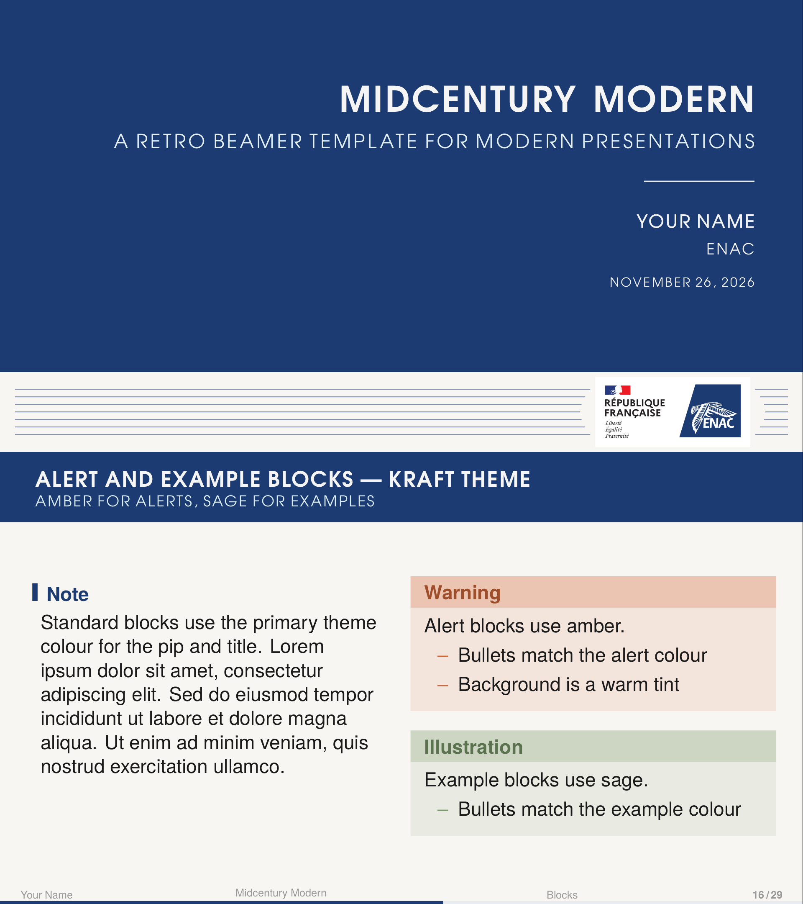
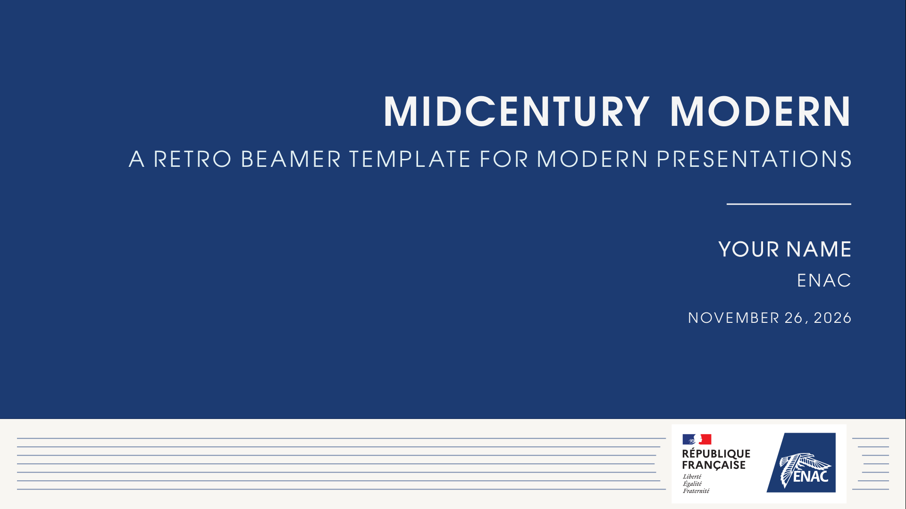
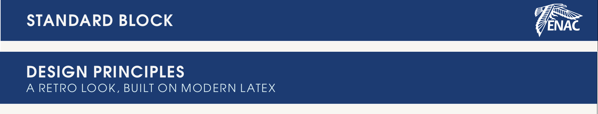
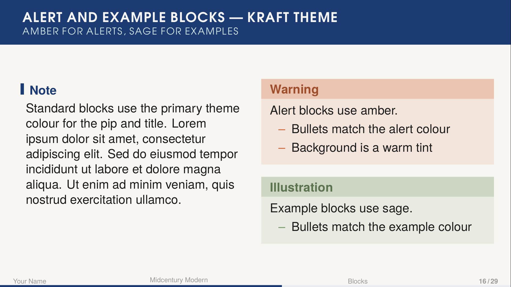
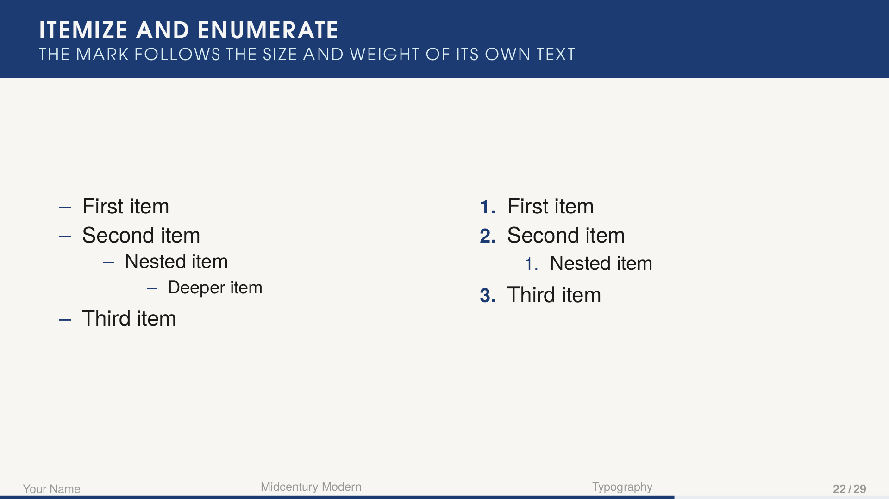
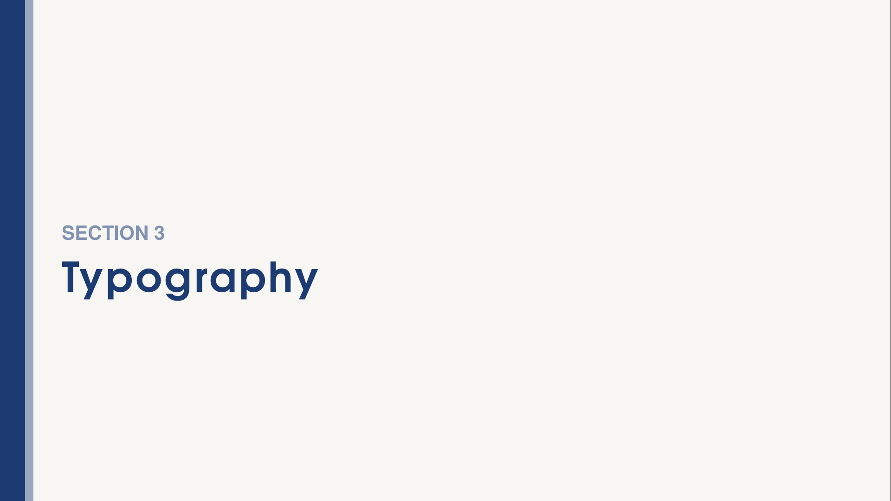
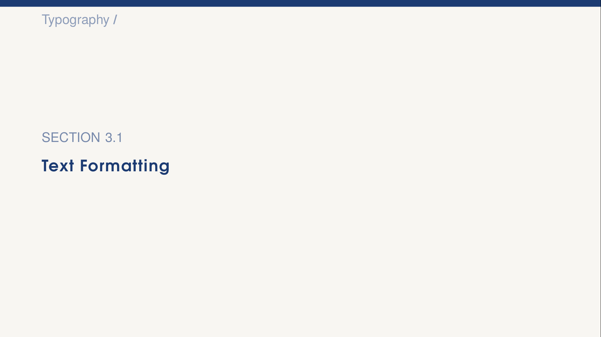
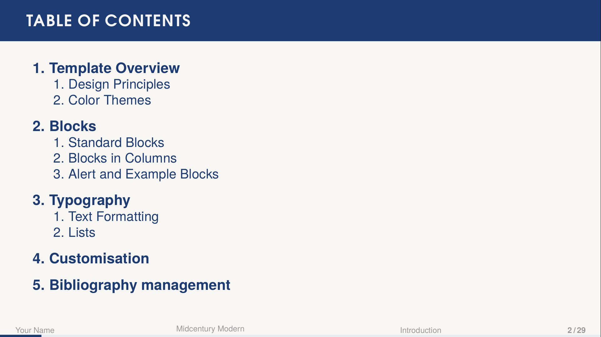

<h1 align="center">
<picture>
  <source media="(prefers-color-scheme: dark)" srcset="logos/logo-deepblue-dark.svg">
  
</picture>
<picture>
  
</picture>
</h1>


<div align="center">

</div>

**Midcentury Modern** is a Beamer template with a retro feel by [Jules Leguy](https://github.com/jules-leguy/midcenturymodern). This repository contains a slightly adapted theme dedicated to ENAC. It requires LuaLaTeX.

<!-- Open it in [the Overleaf gallery](https://www.overleaf.com/latex/templates/midcenturymodern-beamer-theme/zdvwhytpqvgf) to start from a working project without installing anything, or clone this repository (see [Getting started](#getting-started)). -->

Clone this repository to get started (see [Getting started](#getting-started)). *Overleaf integration is still to be done.*

## Built-in themes

The template ships with three colour themes. **Kraft** leans warm, with terracotta and kraft paper tones. **DeepBlue** goes in the opposite direction, with a dark navy background and icy blue accents. **ENAC** is a slightly modified *DeepBlue*, where the blue used matches the ENAC 2020 graphic chart.

Select a theme in your preamble:

```latex
\usepackage{beamerthememidcenturymodern}
% \mcmTheme{Kraft}      % warm terracotta palette
% \mcmTheme{DeepBlue}   % dark navy palette
\mcmTheme{ENAC} % dark blue palette, ENAC-compliant
```


*Title slide — ENAC theme. The logo is set using `\titlegraphic{...}`.*

## A look at the slides

Every frame title sits in a coloured band, and can carry a subtitle on a second line. The band opens by 3 mm to take it, not by a whole line.
A logo can be set to the right end of the frame title by using `\logo{...}`.


*The band with a title alone and the ENAC logo, and with a title and a subtitle (without logo).*

The theme supports standard, alert, and example blocks, each with a coloured accent that adapts to the active theme.

The footline includes a progress bar, the author, the presentation
short title, the current section and the slide counter.
Showing the current section is an original addition compared to the initial Midcentury Modern style.


*Alert and example blocks — ENAC theme.*

Lists are marked with the running font's own en dash at every nesting level, so the mark follows the size and weight of the text it belongs to.


*Itemize and enumerate — ENAC theme. Compared to the original, `enumerate` defaults to [number.] instead of [number] only.*

Section and subsection pages give the audience a clear visual indication of where they are in the talk.



*Section and subsection pages — ENAC theme.*

The Table of Contents is also modified to show the section and subsection numbers.
Similarly, the section counter handling has been revised in order to avoid counting starred sections (such as `\section*{Introduction}`), since they do not get a number in the Table of Contents.


*Table of Contents page — ENAC theme.*

The full demo slides [are available here](demo.pdf).

## Getting started

Clone the repository and place `beamerthememidcenturymodern.sty` in the same directory as your `.tex` file, then:

```latex
\documentclass[aspectratio=169]{beamer}
\usepackage{beamerthememidcenturymodern}
\mcmTheme{ENAC}

\title{Your Title}
\author{Your Name}
\institute{Your Institution}
\date{\today}
\titlegraphic{\includegraphics[height=0.8cm]{your-logo.pdf}}
\logo{\includegraphics[height=0.9cm]{logos/slide-logo-ENAC-white.pdf}}

\begin{document}
\begin{frame}
  \titlepage
\end{frame}
\end{document}
```

Compile with LuaLaTeX.

The logo on the title page is your own: set it with `\titlegraphic`, giving it a height rather than a width — the footer strip is built around the logo's height. Leave it out and the scan lines run the full width of the strip.

## Feedback

Bug reports, suggestions, and pull requests are very welcome.

## Credits

The template was initially made by Jules Leguy, and is available on [Github](https://github.com/jules-leguy/midcenturymodern)